# [Communication Signal]QAM, BPSK, QPSK, SSB modulation and demodulation, bit error rate, eye diagram, constellation diagram MATLAB code

1. BPSK
2. QPSK
3. 16QAM
4. 64QAM
5. SSB
​
More radar and communication MATLAB codes
SSB example code
Close all\nclc\nclear\n​\n% Set simulation parameters\nglobal dt t f df N T\nN=2^10; \ndt=0.01; \ndf=1/(N*dt); \nT=N*dt; \nBs=N*df/2; \nt=linspace(-T/2,T/2,N); \nf=linspace(-Bs,Bs,N)+eps; %Modulation signal and carrier fc=20; A=1.2; \nmt=cos(2*pi*fm*t); \nct=cos(2*pi*fc*t); \nst=sin(2*pi*fc*t); \nS1=t2f(mt); \nPs1=S1.*conj(S1)/T; \n% Adjusted SSB signal \nssb=A*real(mt1.*exp(j*2*pi*fc*t)); \nS2=t2f(ssb); \nPs2=S2.*conj(S2)/T; \n% Band white Gaussian noise \nNC=lpf(t2f(nc),fm); \nnc=real(f2t(NC)); \nNS=NC.*(-j*sign(f)); \nns=real(f2t(NS)); \nnr=nc.*ct-ns.*st; \n% Received Signal and Demodulated Signal \nS3=lpf(t2f(sr.*ct),fm+1); \nyt=real(f2t(S3)); \nPs3=S3.*conj(S3)/T; \n​\nfigure(1); \nsubplot(2,1,1); \nplot(t,mt); \ntitle('m(t) signal waveform'); \naxis([0 2 -1.5 1.5]); \nsubplot(2,1,2); \nplot(f,Ps1); \naxis([-25 25 0 1.5]); \ntitle('m(t) signal power spectrum'); \nxlabel('f (MHz)'); \nylabel('Pr(f) (w)'); \n​\nfigure(2); \nsubplot(2,1,1); \nplot(t,ssb); \ntitle('SSB Modulation Signal Waveform'); \naxis([0 2 -2 2]); \nsubplot(2,1,2); \nplot(f,Ps2); \naxis([-50 50 0 2.5]); \ntitle('SSB Modulation Signal Power Spectrum'); \nxlabel('f (MHz)'); \nylabel('Pr(f) (w)'); \n​\nfigure(3); \nsubplot(2,1,1); \nplot(t,yt); \ntitle('Demodulation Signal Waveform'); \naxis([0 2 -1.5 1.5]); \nsubplot(2,1,2); \nplot(f,Ps3); \naxis([-50 50 0 1.5]); \ntitle('Demodulation Signal Power Spectrum'); \nxlabel('f (MHz)'); \nylabel('Pr(f) (w)'); \n​\n\n

## Images

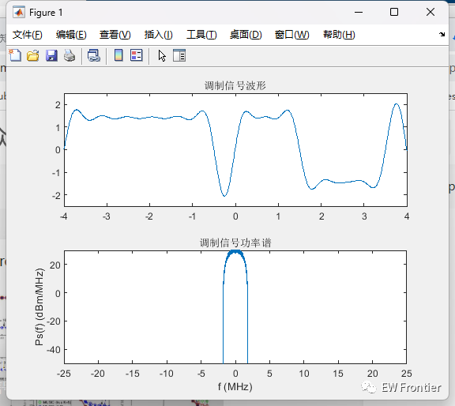
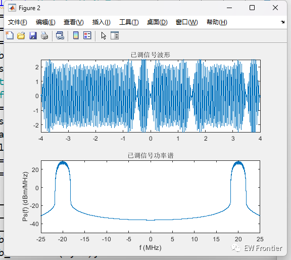
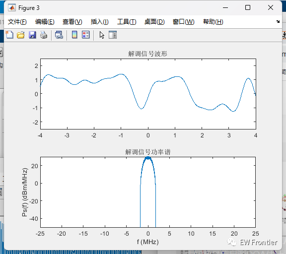
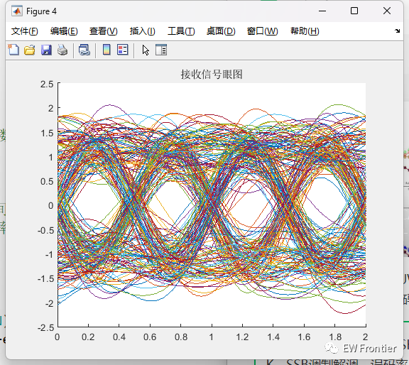
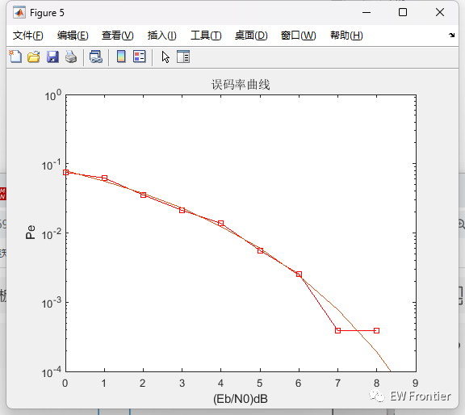
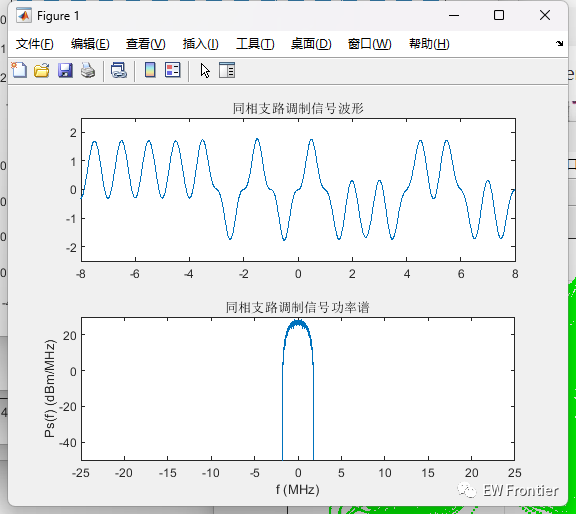
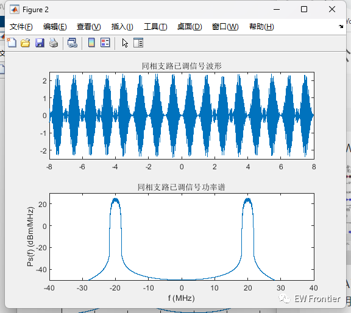
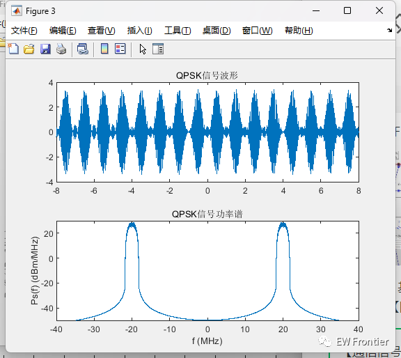
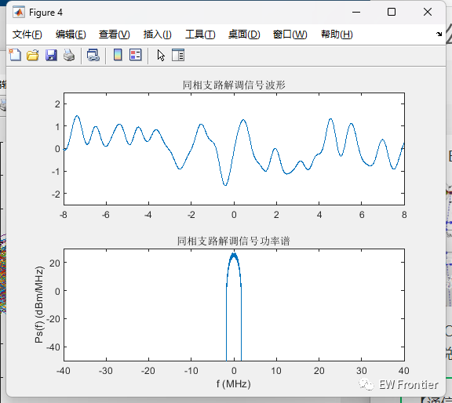
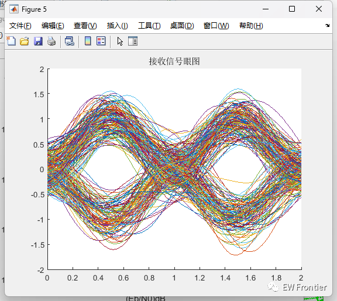
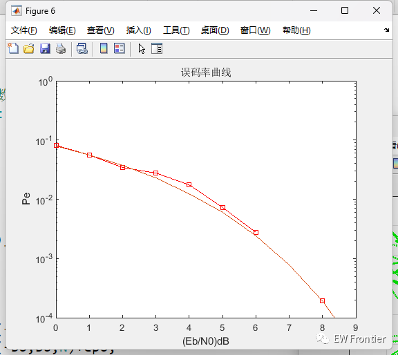
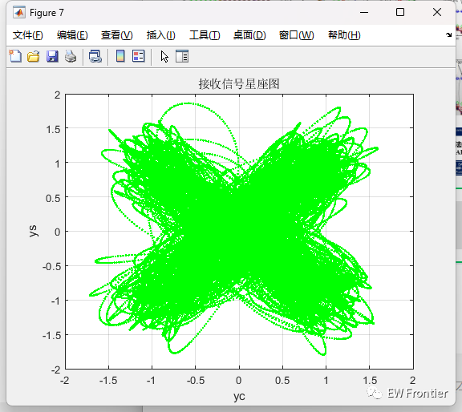
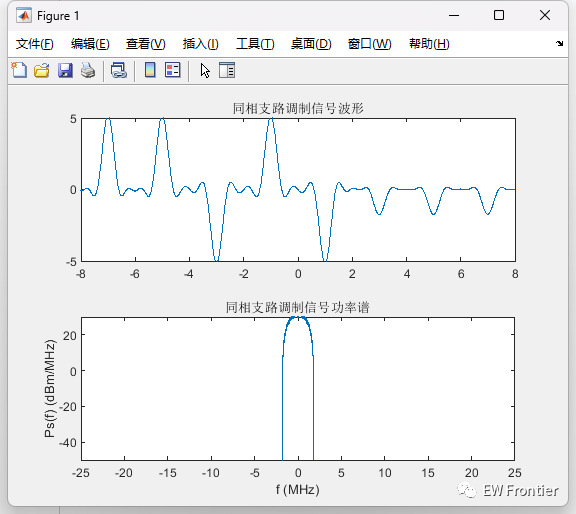
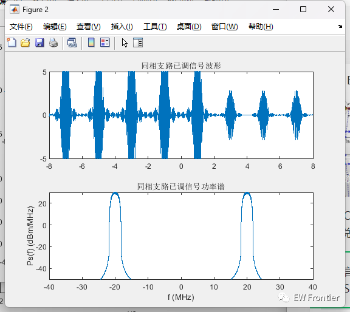
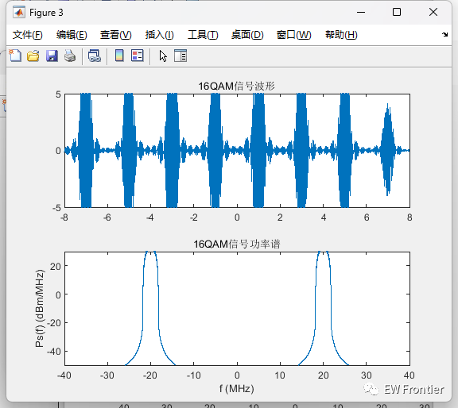
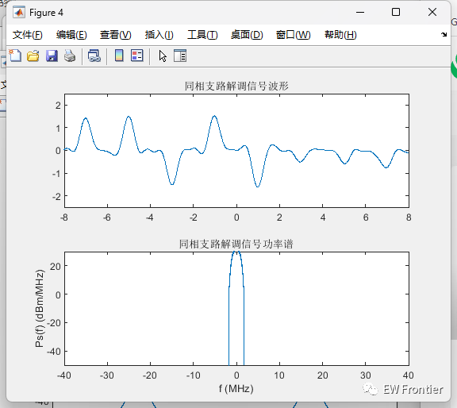
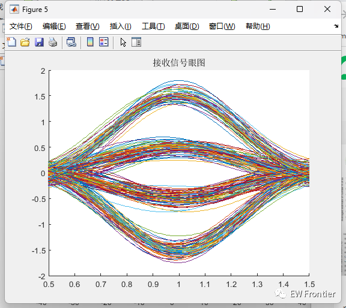
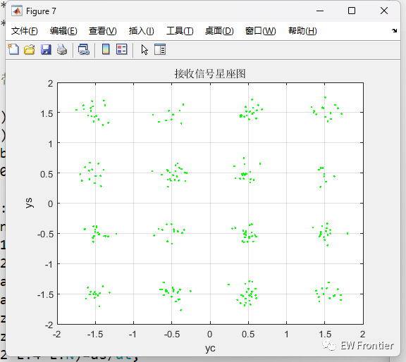
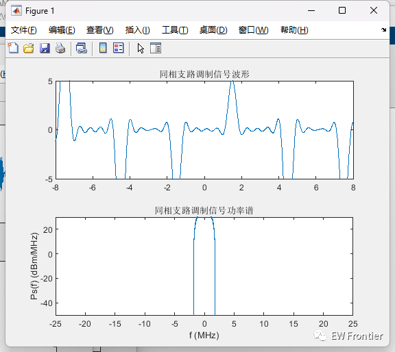
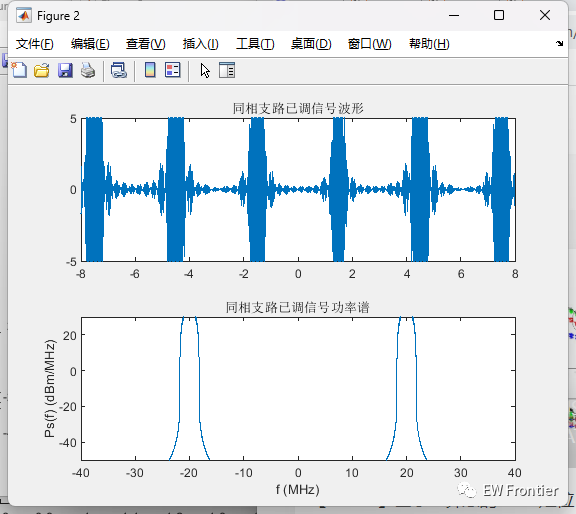
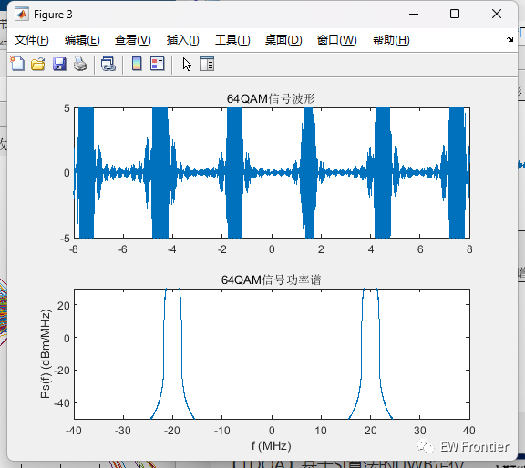
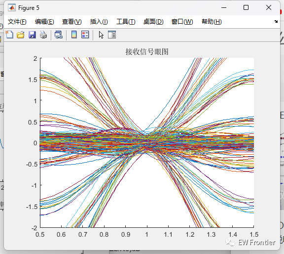
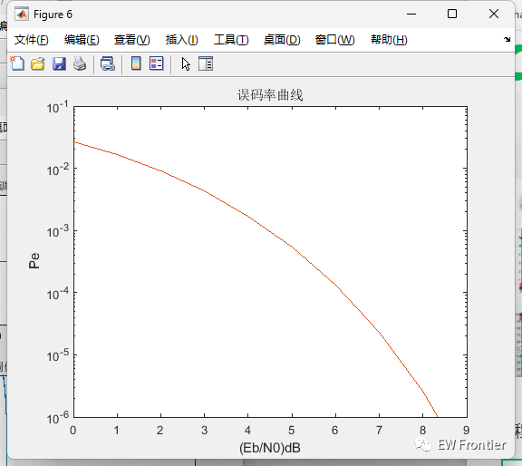
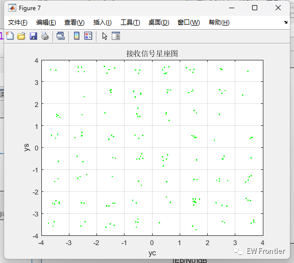
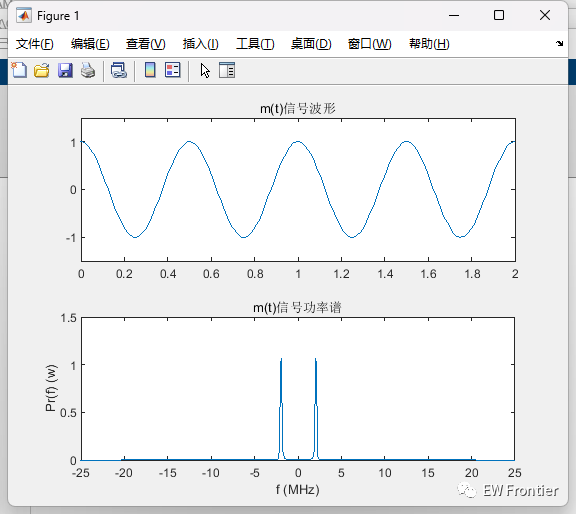
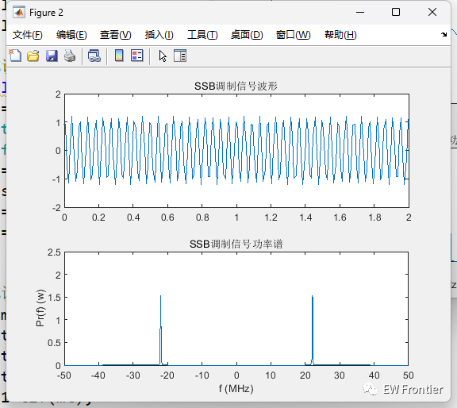
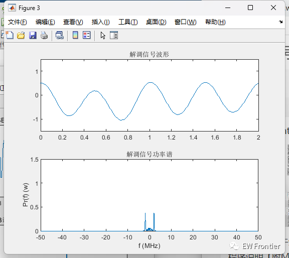

<!-- PAYMENT_BLOCK -->

## Get this dataset

- Payment link (Stripe): [Buy now](https://buy.stripe.com/3cs8yP7sY87d0vu9AB)
- Payment QR code: 

<!-- /PAYMENT_BLOCK -->
